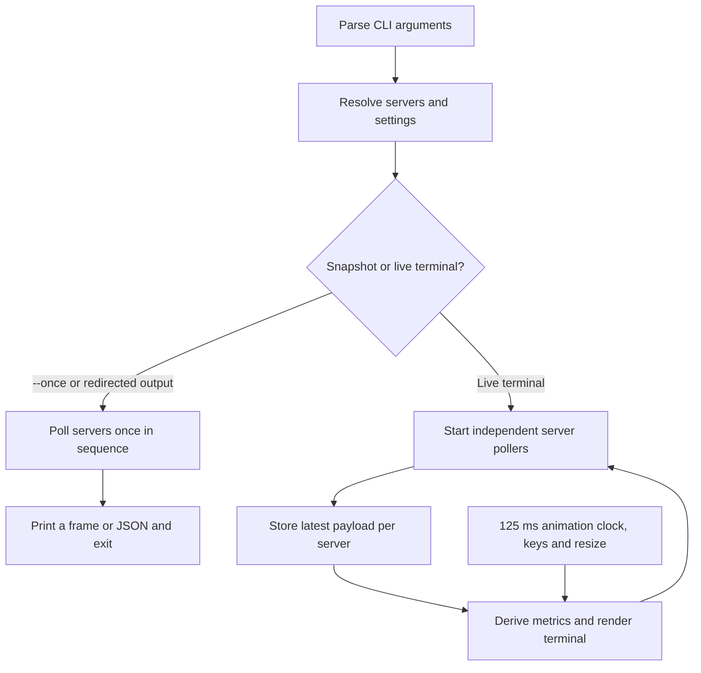

# Strata CLI

A terminal monitor for the [Strata](https://github.com/Niko1221/Strata) inference
server — the same numbers the [Strata Widget](https://github.com/wahackr/Strata-Dashboard)
draws in its Electron window, rendered in your shell, for as many servers as you
point at. No runtime dependencies: Node 24 and ANSI only.

```
✴ Strata CLI  ·  1 server  ·  refresh 0.5s  ·  theme dark  ·  ./strata.json
╭─ ▸ ✴ Home · ● idle 25ms ───────────────────────────────────────────────────────────────╮
│ http://127.0.0.1:8080  ·  qwen3.8-flash-next                                           │
│            z   srv-1    ● idle                                                         │
│     _   _        Waiting for a request                                                 │
│    | | | |       last: 263 tokens at 36.1 tok/s                                        │
│    | |_| |       ░░░░░░░░░░░░░░░░░░░░░░░░░░░░░░░░░░░░░░░░░░░░░░░░░░░░░░░░░░░░░░░░░░░░░ │
│   /       \      refresh 0.5 s · key config                                            │
│  |  -   -  |                                                                           │
│  |    x    |                                                                           │
│   \_______/                                                                            │
│   Speed  36.1 t/s ▁▁▁▅▆▇██▇▇      PCIe   Gen3 x16 · … ▁▅▅▁▁▅▁▁▁▃                       │
│   GPU 0  Tesla P40                 ░░░░░░░░░░░░░░░░░░░  0% · 21.9/23 GB · 62 °C · 52 W │
│   GPU 1  RTX 4070                  ░░░░░░░░░░░░░░░░░░░  0% · 11.8/12 GB · 46 °C · 24 W │
│   CPU    60 % ▁▁▁▂▅▅▅▆▅▅          Disk   105 MB/s · … ▇██▃▁▁▁▁▁▁                       │
│   Ctx  14%  ███████░░░░░░░░░░░░░░░░░░░░░░░░░░░░░░░░░░░░░░░░░░  18,191 / 128k           │
│   Cache 10,918 experts · 13.3 GB    RAM 20.3 / 31 GB     ███████░░░                    │
│   Last 04:39:58 PM  Done · 17,928 in / 15,630 reused / 263 out · 36.1 t/s              │
╰────────────────────────────────────────────────────────────────────────────────────────╯
q quit · space refresh · c compact · d theme · m mascot · 1-9 focus · ↑/↓ select
```

Two GPUs in one server, so the GPU %/VRAM/Temp/Power cards become one row per
slot — the `GPU 0` / `GPU 1` pair above. The panel grows to fit both GPUs. See [Multi-GPU](#multi-gpu).

## Contents

- [How it works](#how-it-works)
- [Usage](#usage)
- [Development](#development)
- [Releases](#releases)

## How it works



1. **Startup and configuration.** `bin/strata.js` parses flags and handles
   `--help`. Explicit `--server` entries replace the configured server list.
   Otherwise, `config.js` loads `--config`, then searches `$STRATA_CONFIG`,
   `./strata.json`, and the user's config directory in that order. With no file,
   it watches `http://127.0.0.1:8080`. It normalizes server settings and resolves
   API keys; display flags override the loaded display settings.
2. **Choose an output mode.** `--once` or output redirected to a pipe/file
   selects a snapshot: each server is polled in sequence, then the CLI prints
   a terminal frame, or structured JSON with `--json`. It exits with code `0`
   if at least one server's metrics request succeeded, otherwise `1`. In a live
   terminal, `app.js` starts a `Poller` for each server and sets up keyboard and
   resize handlers.
3. **Fetch server data.** `client.js` requests `/metrics`, using a Bearer header
   when a key is configured and a default timeout of 4 seconds. If metrics fail,
   the poll returns an error payload and skips `/health`. If metrics succeed,
   it requests `/health` with a 6-second timeout; a health failure leaves health
   data empty without discarding the metrics. Each live poller runs immediately,
   then at its server's refresh interval. A tick is skipped while that server's
   previous poll is still running, including when you press space to refresh.
4. **Turn payloads into a view.** Each completed poll replaces that server's
   stored payload and triggers a redraw. `derive.js` extracts display values
   such as speed, GPU usage, memory, and context from the payload. Failed polls
   display an error; otherwise queued work takes priority over the reported live
   state. `render.js` builds panels or compact rows to fit the terminal, using
   `format.js` for numbers, gauges, colors, and ASCII fallback, and `mascot.js`
   for the animated face.
5. **Keep the live view responsive.** A separate 125 ms clock redraws the latest
   stored data and advances the animation without making network requests.
   Keyboard changes and terminal resizes also redraw the view. Display changes
   stay in memory for the session. On `q`, Ctrl-C, or a termination signal,
   the app clears its timers, restores terminal input mode and cursor visibility,
   leaves the alternate screen when used, and exits.

### Terminal redraws

Each frame homes the cursor, rewrites every line, and erases
whatever is left below the last one, so toggling `c` for compact mode or
shrinking the terminal never leaves rows of the previous frame behind. The
screen is cleared once on entry, not per frame, so the display doesn't flicker
while the mascot animates. That entry switch uses the alternate screen so your
scrollback survives the session, and is skipped when `TERM` doesn't advertise
one — there the frame draws inline instead of landing on a screen nothing paints.

## Usage

### Quick start

```bash
# Requires Node.js 24 or newer; no install needed to run the CLI
node bin/strata.js
```

or `npm start`. With no config file it watches `http://127.0.0.1:8080` with no
key.

One snapshot instead of the live view (works over SSH pipes and in CI):

```bash
node bin/strata.js --once
node bin/strata.js --once --json | jq '.[0].metrics.live'
```

### Configuration

Use `--config <file>` to select a file explicitly. Otherwise, the CLI searches
`$STRATA_CONFIG`, `strata.json` in the working directory, then
`$XDG_CONFIG_HOME/strata-cli/config.json` (defaulting to
`~/.config/strata-cli/config.json`). See `config.example.json`:

```json
{
  "refreshMs": 1000,
  "timeoutMs": 4000,
  "theme": "dark",
  "compact": false,
  "mascot": true,
  "servers": [
    { "name": "Home", "url": "http://127.0.0.1:8080", "apiKeyEnv": "STRATA_HOME_KEY" },
    { "name": "Office", "url": "http://192.168.1.20:8080",
      "apiKey": "bearer-key", "refreshMs": 2000, "timeoutMs": 6000 }
  ]
}
```

- **Multiple servers** — one panel per entry, each with its own URL, key, and
  refresh rate. Per-server `refreshMs` / `timeoutMs` override the global value.
- **Credentials** — `apiKey` in the file, or `apiKeyEnv` naming an environment
  variable. An environment variable beats a stale key in the file, so a rotated
  key never silently stays the old one. Strata is unauthenticated by default, so
  an absent key is fine.
- **Permissions** — a config file readable by other users warns, because it may
  hold keys. `chmod 600 strata.json`. `strata.json` is gitignored.
- **Refresh rate** — `refreshMs` (floor 250ms). The mascot animates on its own
  125ms clock, so a 5s refresh interval still looks alive between polls.

A flat single-server file (`{ "url": …, "apiKey": … }`) is accepted and treated
as one server, matching the widget's migration of old `settings.json` files.

### Flags and keyboard controls

| Flag | Effect |
|---|---|
| `--config <file>` | use this config file |
| `--server <url>` | watch this server instead of the file; repeatable |
| `--name <name>` / `--key <key>` | label / Bearer key for the preceding `--server` |
| `--interval <1500\|1.5s>` | refresh rate for every server |
| `--timeout <ms>` | metrics request timeout (`/health` always gets 6s) |
| `--theme <dark\|light>` | theme |
| `--compact` | one line per server, like the widget's compact strip |
| `--no-mascot` / `--no-color` | hide the bunny / drop ANSI |
| `--color [auto\|16\|256\|truecolor\|console\|never]` | force a palette depth |
| `--ascii` / `--no-ascii` | force ASCII glyphs / force the Unicode glyphs (`--utf8` = `--no-ascii`) |
| `--once` | poll each server once, print, exit |
| `--json` | with `--once`, raw payloads for piping |

Keys in the live view: `q` quit · `space` refresh now · `c` compact · `d` theme ·
`m` mascot · `1-9` focus a server · `↑`/`↓` select.

### Bunny mascot

The expanded panel shows a head-only ASCII bunny beside the server status.
Idle uses sleepy eyes, a gently drifting `z`, and occasional open eyes. Reading,
generating, queued, and error states have distinct eyes and accessories; the
rounded head and small `x` mouth stay fixed so animation never shifts the panel.
The head has seven rows plus one accessory row. Hide it with `m` or
`--no-mascot` to return to the shorter five-row status area. Panels collapse to
compact strips when they would exceed the terminal height, including with one
server. Compact strips keep a small face beside the state label.

### Multi-GPU

When `hardware.gpus[]` reports more than one GPU, the consolidated GPU %/VRAM/
Temp/Power cards are replaced by one row per GPU; Speed pairs with PCIe and CPU
with Disk. Single-GPU servers keep today's cards. PCIe stays one card — the
payload only carries server-wide PCIe fields (see issue #4 for per-GPU PCIe).

```
│   Speed  54.4 t/s ▁▂▃▆█▇▄▂▁▁      PCIe   Gen3 x16 · … ▁▁▁▁▁▁▁▁▁▁                       │
│   GPU 0  Tesla P40                 ░░░░░░░░  0% · 21.9/23 GB · 62 °C · 52 W · Gen3 x16 │
│   GPU 1  RTX 4070                  ░░░░░░░░  0% · 11.8/12 GB · 46 °C · 24 W · Gen3 x16 │
│   CPU    0 % ▁▁▁▁▁▁▁▁▁▁           Disk   0.0 MB/s · … ▁▁▁▁▁▁▁▁▁▁                       │
```

With the bunny visible, the panel is `16 + N` rows, so a tall multi-GPU view
collapses to the compact strip (which badges a multi-GPU server as `GPU 0% ×2`) before it would scroll.
Boxes span the full terminal width.

### Colors

Auto paints 24-bit when `COLORTERM` says `truecolor`, 256-color names
when `TERM` says `256color`, and the 8 ANSI names otherwise. The last case
matters: quantizing the lime accent `#b8f36b` to the nearest 256-color slot
lands on yellow, so on a plain terminal (Alpine's tty, `TERM=linux`) the accent
is the bright-green ANSI name instead. Indexed colors are written as `38;5;n` —
a bare palette index is a different SGR verb, where `8` conceals and `10` sets
the background. `NO_COLOR` turns color off and `FORCE_COLOR` turns it on for
pipes; an explicit `--color` beats both.

`TERM=linux` decides the palette before `COLORTERM` is even read, so a
`truecolor` value inherited from a GUI terminal cannot smuggle 24-bit codes into
the kernel vconsole: auto there means `console`, and `--color console` forces
it. In that mode muted text is light grey (`37`) instead of the dark grey (`90`)
that disappears on a black console, borders are cyan (`36`) for the same reason,
and status keeps its recognizable red/green/yellow (`91/92/93`). Borders are
painted in the border color everywhere, rather than inheriting whatever color
the row happened to use.

### Glyphs and ASCII fallback

The bunny uses ASCII in every terminal. The box drawing and block sparklines
use Unicode by default. Auto detects a terminal that can't render them — no
UTF-8 locale (`LANG=C` over ssh),
`TERM=dumb`, `unknown` or `linux` (the kernel console's cp437 font has no
half-blocks) — and replaces every glyph with a same-width ASCII twin: boxes
become `+ - | / \`, the state dot `*`, separators `.`, gauges a bracketed
`[######----]` where `#` is filled and `-` is not, and
sparklines the seven-step scale ` .-+=*#`. One cell in, one cell out, so the box
still lines up. Nothing fills with `@` and no gauge is a run of dots: on a
framebuffer that lacks the half-block glyph, `█` and `░` collapse into each
other, and an all-empty bar of dots read as a full one. A blank sparkline cell
means no traffic — a nonzero sample never maps to it. `--ascii` forces the
fallback, `--no-ascii` forces Unicode, and `STRATA_ASCII=1` / `STRATA_ASCII=0`
do the same for shells you can't pass flags to. The whole preview again in the
ASCII set, which is what `TERM=linux` and any non-UTF-8 shell sees:

```
* Strata CLI  .  1 server  .  refresh 0.5s  .  theme dark  .  ./strata.json
+- > * Home . * idle 25ms ---------------------------------------------------------------+
| http://127.0.0.1:8080  .  qwen3.8-flash-next                                           |
|            z   srv-1    * idle                                                         |
|     _   _        Waiting for a request                                                 |
|    | | | |       last: 263 tokens at 36.1 tok/s                                        |
|    | |_| |       [-------------------------------------------------------------------] |
|   /       \      refresh 0.5 s . key config                                            |
|  |  -   -  |                                                                           |
|  |    x    |                                                                           |
|   \_______/                                                                            |
|   Speed  36.1 t/s    ++###**      PCIe   Gen3 x16 . ~ .==..=...-                       |
|   GPU 0  Tesla P40                 [-----------------]  0% . 21.9/23 GB . 62 C  . 52 W |
|   GPU 1  RTX 4070                  [-----------------]  0% . 11.8/12 GB . 46 C  . 24 W |
|   CPU    60 % ....++++++          Disk   105 MB/s . ~ *##.......                       |
|   Ctx  14%  [#######----------------------------------------]  18,191 / 128k           |
|   Cache 10,918 experts . 13.3 GB    RAM 20.3 / 31 GB     [#####---]                    |
|   Last 04:39:58 PM  Done . 17,928 in / 15,630 reused / 263 out . 36.1 t/s              |
+----------------------------------------------------------------------------------------+
q quit . space refresh . c compact . d theme . m mascot . 1-9 focus . ^/v select
```

### Troubleshooting

**Blank screen?** Three things can hide the frame, in the order they are usually
the culprit:

- **Colors.** When literally nothing shows, borders included, that is conceal
  rather than a dark theme. Test with `--color never`: if the frame appears, the
  terminal is mishandling your color codes. Indexed colors must be `38;5;n` — a
  bare palette index is conceal (`8`) or background (`10`) — and `--color 16`
  falls back to the eight ANSI names.
- **Glyphs.** Box drawing and the block sparklines arriving as `─` or `?` mean
  the terminal is not on a UTF-8 locale. Auto detects this; `--ascii` forces it
  and `STRATA_ASCII=1` sets it for a shell you cannot pass flags to.
- **No alternate screen.** `TERM=dumb` or `unknown` ignores the screen switch, so
  the frame is drawn inline instead — which overwrites the lines below it rather
  than clearing your scrollback.

`--once` sidesteps all three: no screen switch, no cursor movement, one plain
frame you can redirect.

**Visible but hard to read?** That is contrast, not concealment. `--color
console` brightens muted text and borders on the kernel vconsole; `--theme
light` helps on a white-backed terminal, and `--color never` removes color from
the comparison entirely. The ASCII gauges and sparkline scale are legible even
with color off.

## Development

### Working on a change

1. Start a feature or fix branch from `development`.
2. Install the locked development tools with `npm ci`.
3. Make the change and run `npm run check` and `npm test`.
4. For display or polling changes, also check the CLI against a Strata server
   using the command below.
5. Open a pull request into `development`. Use Conventional Commit messages,
   including the final commit message when squash-merging, so release tooling
   can determine the version later.
6. When ready to release, merge the tested changes into `master`. The release
   workflow runs after CI passes; see [Releases](#releases) for branch setup.

### Project layout

```
bin/strata.js          argument parsing, --once / --json, entry point
strata-cli/config.js   config discovery, credential precedence, clamping
strata-cli/client.js   fetch + per-server poll timer (no overlapping polls)
strata-cli/derive.js   payload -> numbers
strata-cli/format.js   numbers, sparklines, bars, palette, ANSI widths, ASCII glyphs
strata-cli/mascot.js   ASCII bunny head: face per state, frames per tick
strata-cli/render.js   boxes, panels, compact strips, header
strata-cli/app.js      animation clock, key handling, screen setup
test/                  geometry + config assertions against the widget's fixture
```

### Validation

```bash
npm run check   # syntax check every source file
npm test        # config, polling, derived numbers, layout geometry, mascot frames
```

`test/config.js` covers server lists, credential precedence, refresh clamping
and permission warnings. `test/client.js` stubs `fetch` and asserts URL joining,
the Bearer header, the 401/timeout/503 shapes, and that a poll never overlaps
the one before it. `test/render.js` renders against `test/metrics.json` (copied
from the widget's fixture) and asserts that every drawn line fits the requested
terminal width, that every escape `paint()` emits is a foreground code rather
than conceal or background, that color and the ASCII fallback change no line
geometry, that an ascii frame holds no byte above U+007F, and that every mascot
frame is the same size. The multi-GPU cases check the `16 + N` row height, the
collapse to the compact strip, and per-slot PCIe. Nothing needs a server or a
TTY.

Against a live server:

```bash
node bin/strata.js --server http://<host>:8080 --key <key> --interval 1s
```

## Releases

Releases use GitHub Actions and semantic-release, following the setup in
[Quickbook-Invoice-Status](https://github.com/AlohaOnline/Quickbook-Invoice-Status).
Only pushes or merges to `master` can produce a release, after CI passes.
The CLI is not published to npm, and the workflow does not deploy a server.

### Workflow

1. [ci.yml](.github/workflows/ci.yml) runs for pushes to `development` or
   `master`, and pull requests targeting either branch. It installs Node
   `24.22.1`, restores dependencies with `npm ci`, runs syntax checks with
   `npm run check`, and runs the assertions with `npm test`.
2. [release.yml](.github/workflows/release.yml) listens for the completion of
   `CI` on `master` through `workflow_run`. Its job runs only when CI succeeded,
   the original event was a push, and the source repository is this repository.
   Merging a pull request produces a push to `master`, so it follows the same
   path. Pull request checks and pushes to `development` cannot release.
3. The release job checks out the exact commit SHA that passed CI and fetches
   the full Git history and tags. It installs dependencies, then runs
   `npm run release`, which invokes `semantic-release` from `package.json`.
   It explicitly sets `GITHUB_REF` to `refs/heads/master` and `GITHUB_SHA` to
   the checked commit because `workflow_run` otherwise uses the default branch
   context.
4. [.releaserc.json](.releaserc.json) restricts releases to `master`. Its plugins
   analyze commits since the last release tag, choose a version, generate release
   notes, update the two package files without publishing to npm, commit those
   files, and publish a GitHub release and version tag such as `v1.2.3`.

The release commit uses `chore(release): <version> [skip ci]`, so its version
update does not start another CI/release cycle. The release concurrency group
allows only one release job to run at a time and does not cancel an active
release when another run arrives.

### Versioning

Use Conventional Commit messages for commits that reach `master`:

| Commit message | Release |
|---|---|
| `fix: correct compact output` | Patch, e.g. `1.2.3` → `1.2.4` |
| `feat: add a new view` | Minor, e.g. `1.2.3` → `1.3.0` |
| A parsed commit with a `BREAKING CHANGE:` or `BREAKING CHANGES:` footer | Major, e.g. `1.2.3` → `2.0.0` |
| `docs:`, `refactor:`, `style:`, `test:`, or `chore:` | Patch, by this repo's custom rules |
| Other messages without a release rule or breaking-change footer | No release |

When several commits qualify, the highest release level wins. If none qualify,
the workflow succeeds without creating a release. With no existing release tags,
the first qualifying release is `v1.0.0`; subsequent versions come from release
tags rather than the current `package.json` version alone. When squash-merging,
give the final squash commit a Conventional Commit message because the original
individual commit messages will not be on `master`.

### Branch setup and permissions

The workflow uses the built-in `GITHUB_TOKEN`; no extra secrets are needed.
The release job requests write access to repository contents, issues, and pull
requests so semantic-release can publish releases and update linked items.
Repository rules must allow GitHub Actions to push the version update to
`master`.

`master` does not need to exist when these files are added. First merge the
workflows and release configuration into `development`, the repository's default
branch: GitHub requires the release workflow there for `workflow_run` events.
Then create `master` from a commit containing the same workflow files and release
tooling. Its initial push and future pushes or merges run CI and, if qualifying
commits exist, release automatically.
